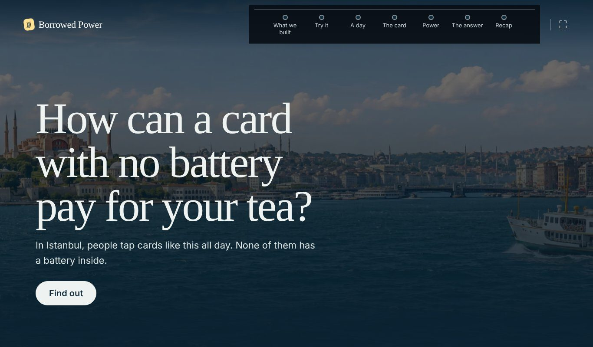
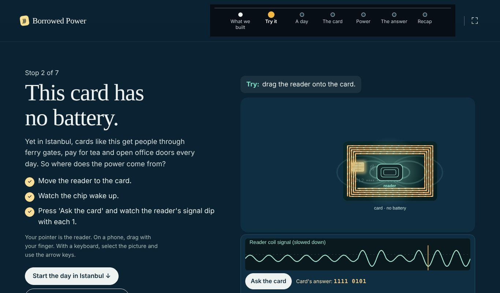
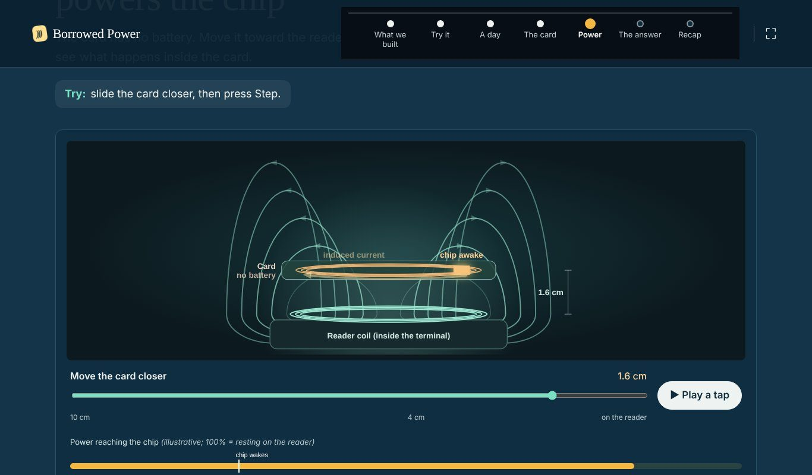
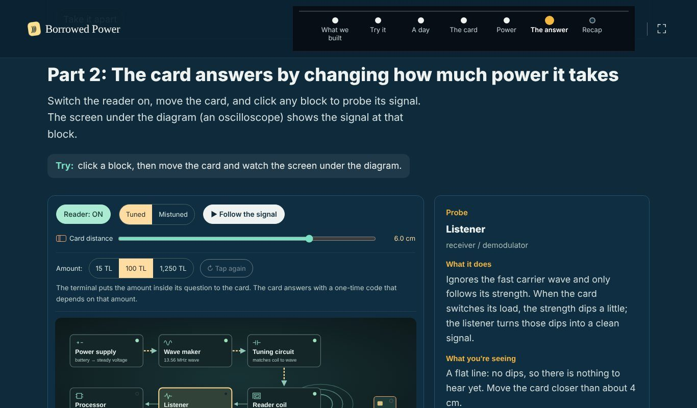

  

<h1 align="center">Borrowed Power</h1>

  <b>A contactless card has no battery. So how does it open a ferry gate?</b> 
  An interactive website that shows how the card borrows its power from the reader, and how it answers without a transmitter.

  <a href="https://mensar10.github.io/borrowed-power/"><b>▶ Open the live site</b></a>
  &nbsp;·&nbsp; Global Virtual Hackathon 2026 · <i>Unveiling Technology</i>
  &nbsp;·&nbsp; Team <b>İstikbalin Cezerileri</b>, Istanbul

---

## The idea in one sentence

> **The reader's magnetic field powers the chip, and the card answers by changing how much power it takes.**

## Try it in 60 seconds

1. Open the [live site](https://mensar10.github.io/borrowed-power/).
2. At **Try it**, drag the reader (your pointer or finger) onto the card and watch the chip wake up.
3. Press **Ask the card** and watch the reader's signal dip with each 1.

  

## What's on the page

| | Stop | What you do | What you learn |
|---|---|---|---|
| 0 | The question | Read one question | How can a card with no battery pay for your tea? |
| 1 | What we built | Read three steps: move, press, watch | What the site lets you do |
| 2 | Try it | Drag the reader onto a card, press "Ask the card" | The chip only wakes when the reader is close, and the card answers by changing how much power it takes |
| 3 | A day | Scroll through one day in Istanbul | How many ordinary moments use a contactless tap |
| 4 | The card | Open the card layer by layer | There is a coil and a chip inside, but no battery |
| 5 | Power | Slide the card closer, step through Catch, Fill, Wake, Answer | How power reaches the chip through the reader's field |
| 6 | The answer | Use the Reader lab: distance, tuning, payment amount | How the reader feels the card's answer, and why the amount changes the bits but not the power |
| 7 | Recap | Reveal the answer | Where else the same idea is used |

  
  

## How it works (the code)

- **One HTML file**, plain JavaScript, SVG and `<canvas>`. No frameworks or libraries, so every line can be read and explained.
- **One shared model, `powerAt(d)`**: turns the card's distance `d` (cm) into the relative power reaching the chip, where 1 means the card is resting on the reader. The chip wakes above `WAKE` (about 4 cm in our model). The intro, Part 1 and the Reader lab all use this same function.
- **`waveAt()`** computes the reader's signal on the scope, including the dips made when the card switches its load.
- **Every result is computed from your inputs.** Each "Ask the card" creates new answer bits; a card further away makes smaller dips.
- **One animation loop** (`requestAnimationFrame`) drives every moving part, and the site follows the `prefers-reduced-motion` setting.
- Photos are compressed WebP files in `img/`.

**Run it locally:** no install or build step. Serve the folder (for example `python3 -m http.server`) and open `index.html`.

## What we simplified

- Signals are slowed down; heights are relative, not measured.
- The power curve is an illustrative shape, not a physical law.
- The real field runs at 13.56 million cycles per second.
- Bits in the Reader lab are illustrative, not the real encoding.
- Bank-card security (the one-time code) is shown only as an idea.
- A phone uses its own battery for NFC.
- The reader, terminal and bank decide; the card only answers.

## Sources

- NXP Semiconductors, [PN5180 NFC frontend: product data sheet](https://www.nxp.com/docs/en/data-sheet/PN5180A0XX_C3_C4.pdf) and [product page](https://www.nxp.com/products/rfid-nfc/nfc-hf/nfc-readers/full-nfc-forum-compliant-frontend-ic:PN5180). A real reader chip for payment terminals; we used it to name the reader's blocks.
- NFC Forum, [NFC technology](https://nfc-forum.org/learn/nfc-technology). How NFC devices work with ISO/IEC 14443 readers and cards.
- ISO/IEC 14443-2, [Radio frequency power and signal interface](https://webstore.ansi.org/Standards/ISO/ISOIEC144432020). The standard for how a reader powers a contactless card and how they talk (we used the public summary and contents, not the paid text).

Thanks to Dr. Taylan Başkan (Karadeniz Technical University), who answered our questions. He did not review the site.

## Use of AI tools

We used **Claude** (Anthropic) to help build the prototype (the website code) and the presentation materials (texts and the demo video), and **ChatGPT** (OpenAI) to generate the photos. We chose the topic, the explanations and the design decisions, checked the physics against the sources above, and can explain every part of the code.

## Team

**İstikbalin Cezerileri**, Istanbul

- Eymen Efe Çetin
- Mustafa Ensar Erol

## License

[MIT](LICENSE): anyone may use, copy and change this code, as long as they keep the copyright notice. The photos are AI-generated illustrations for this project.
